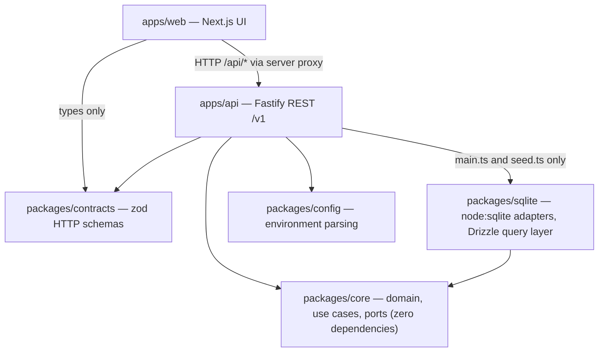

<div align="center">

# OpsKit

**A configurable operations template — inventory, invoicing, payments, cash sessions, people, offerings, compensation and organization policy.**

[](https://nodejs.org)
[](https://www.typescriptlang.org)
[](https://fastify.dev)
[](https://nextjs.org)
[](https://nodejs.org/api/sqlite.html)
[](https://vitest.dev)
[](https://docs.npmjs.com/cli/using-npm/workspaces)
[](LICENSE)

</div>

---

OpsKit is a generic operations template covering inventory, invoicing, payments, cash sessions, people, offerings, compensation, and organization policy. It is intentionally free of company-specific rules and external backend services.

The policy boundary is `OrganizationSettings`: currency, time zone, payment methods, enabled modules, stock behavior, invoice behavior, and role permissions are **data**, not code. Changing how the business works means editing settings, not forking the domain.

## Contents

- [Quick start](#quick-start)
- [Working in this repository](#working-in-this-repository)
- [Architecture](#architecture)
- [Commands](#commands)
- [Configuration](#configuration)
- [API overview](#api-overview)
- [Permission model](#permission-model)
- [Domain modules](#domain-modules)
- [Compensation engine](#compensation-engine)
- [Persistence and migrations](#persistence-and-migrations)
- [Local data](#local-data)
- [Project documents](#project-documents)
- [License](#license)

## Quick start

Prerequisites: **Node 24 or newer** and npm. There are no native add-ons to build.

```bash
cp .env.example .env
npm install
npm run seed
npm run dev
```

Open <http://localhost:3000>. The seed reads `DEMO_ADMIN_EMAIL` and `DEMO_ADMIN_PASSWORD` from `.env`; set your own values before any shared use.

To run the two processes separately while debugging:

```bash
npm run dev:api
# in another terminal
npm run dev:web
```

## Working in this repository

> If you are an AI agent or a first-time contributor, this is the section to read. Everything below is enforced by tests or config in this repository — not convention.

### Start state

- Work from the repository root. npm workspaces resolve the six workspaces from there.
- Copy `.env.example` to `.env` before running anything that touches the database or the API.
- `node_modules/` is installed at the root; there is nothing to install per workspace.
- The database file does not exist until `npm run seed` or the first API start.

### Where things live

| Path | Owns | Workspace dependencies | External runtime dependencies |
| --- | --- | --- | --- |
| `packages/core` | Domain rules, use cases, and ports. Framework- and database-independent. | — | — |
| `packages/sqlite` | Port implementations over `node:sqlite`, migrations, Drizzle query layer | `core` | `drizzle-orm` |
| `packages/contracts` | Zod HTTP request/response schemas | — | `zod` |
| `packages/config` | Runtime environment parsing | — | `zod` |
| `apps/api` | Fastify REST API under `/v1`; the composition root | `core`, `sqlite`, `contracts`, `config` | `fastify`, `@fastify/cookie`, `zod` |
| `apps/web` | Next.js UI; reaches the API over HTTP only | `contracts` *(types only)* | `next`, `react`, `react-dom` |

### Architecture invariants

`packages/core/test/architecture-boundaries.test.ts` scans the real tree and fails the build when any rule below is broken. It also self-tests its own detector against fixtures, so the check cannot silently stop detecting.

| Invariant | Rule |
| --- | --- |
| Core stays independent | `packages/core/src/**` must not import `@opskit/sqlite`, `fastify`, `next`, `zod`, or `node:sqlite` |
| Adapters never call into use cases | `packages/sqlite/**` must not import `application` or `use-case` modules |
| HTTP layer never touches the database | `apps/api/src/**`, except `main.ts` and `seed.ts`, must not import `@opskit/sqlite`, `Sqlite*Repository`, `Sqlite*Adapter`, or `ApiDependencies` |
| Only the composition root builds adapters | `new Sqlite*` may appear only in `apps/api/src/main.ts` and `apps/api/src/seed.ts` |
| Web never touches domain or database | `apps/web/**` must not import `@opskit/core` or `@opskit/sqlite` |
| Drizzle stays in the adapter package | `packages/core/src`, `apps/api/src`, and `apps/web` must not import `drizzle-orm`; `packages/sqlite` is the only importer |
| Repositories use the query builder | `packages/sqlite/src/{repositories,operations-repositories,compensation-repositories}.ts` must not call `prepare(` or use raw `SELECT` / `INSERT` / `UPDATE` / `DELETE` SQL strings |
| Repositories stay pure | `packages/sqlite/src/*repositories.ts` must not use `randomUUID`, `new Date`, `COUNT(*)+1`, `.padStart`, or `INV-` — identifiers, clock, and document numbering come from core. Comments and string literals are stripped before matching, so this checks executable code |

If you need to add a capability, put the rule in `packages/core`, add the port, then implement the port in `packages/sqlite`, and only then expose it from `apps/api`. Reversing that order breaks the invariants above.

### Verify before you claim done

| Command | What it proves |
| --- | --- |
| `npm run typecheck` | Every workspace compiles. **Does not cover `apps/web/test`.** |
| `npm run typecheck:test -w @opskit/web` | The web test tree compiles (not part of the root script). |
| `npm test` | `vitest run` over `packages/*/test`, `apps/api/test`, `apps/web/test`. |
| `npm run lint` | `eslint .` |
| `npm run build` | `tsup` for the API, `next build` for the web app. |

### Gotchas

1. **Node 24 is a hard floor.** `node:sqlite`'s `DatabaseSync` is the only driver. There is no `better-sqlite3`, no `sqlite3`, and nothing to compile.
2. **ESM in the workspace packages.** The root manifest, `apps/api`, and all four `packages/*` declare `"type": "module"`; `apps/web` does not, because Next resolves modules itself. Relative imports inside the workspace packages need the `.js` suffix even in `.ts` source.
3. **`next-env.d.ts` is generated but gitignored.** It is listed in the web tsconfig `include` yet kept out of version control, and is written by `next dev` or `next build`, so a fresh clone starts without it.
4. **`apps/web/test/*.test.tsx` are not collected.** The Vitest `include` glob is `*.test.ts` only. The `.ts` counterparts are the ones that run.
5. **Vitest runs in the `node` environment globally.** Web component tests get JSX from `esbuild.jsx: "automatic"` with `oxc: false` in `vitest.config.ts`, not from a jsdom default.
6. **`.env` lives at the repository root, but paths in it resolve from the workspace.** npm runs workspace scripts with the workspace as cwd, so `DATABASE_PATH=./data/opskit.db` lands in `apps/api/data/`.
7. **`API_INTERNAL_URL` bypasses `packages/config`.** The web proxy route reads it directly, with a `http://127.0.0.1:4000` fallback.
8. **The web proxy forwards only `GET`, `POST`, `PUT`, and `OPTIONS`.** There is no `DELETE` or `PATCH` path through it.
9. **`drizzle-orm` is pinned to a release candidate** (`^1.0.0-rc.4`) and is a query layer only. Migrations are hand-written SQL; Drizzle never generates or applies them.

## Architecture



Dependencies point inward. `packages/core` imports nothing from the other workspaces and has no runtime dependencies at all — see the [architecture invariants](#architecture-invariants) for the rules that keep it that way.

- `packages/core` contains framework- and database-independent domain policies, use cases, and ports.
- `packages/sqlite` implements the ports with Node 24's built-in `node:sqlite` and applies local migrations. This avoids native add-ons, is compatible with the declared Node 24 runtime, and keeps the template dependency-light.
- `packages/contracts` owns HTTP request schemas shared by the API and the web app.
- `packages/config` parses runtime environment configuration.
- `apps/api` is a thin Fastify REST API under `/v1`. It accepts Bearer sessions and secure HTTP-only cookie sessions; cross-origin cookie mutations are rejected.
- `apps/web` is a minimal Next.js UI that talks only to the REST API proxy. It never imports SQLite.

## Commands

All commands run from the repository root.

| Command | Purpose |
| --- | --- |
| `npm run dev` | API and web together, with prefixed interleaved output |
| `npm run dev:api` | API only (`tsx watch`, loads `../../.env` if present) |
| `npm run dev:web` | Web only, on port 3000 |
| `npm run seed` | Create the demo organization, the admin user, and catalog data |
| `npm test` | Run the full Vitest suite once |
| `npm run typecheck` | Type-check every workspace |
| `npm run lint` | ESLint across the repository |
| `npm run build` | Build API and web for production |
| `npm start -w @opskit/api` | Run the built API (`dist/main.js`) |

## Configuration

Every variable is optional: `packages/config` declares defaults with Zod and parses the environment, so a missing variable is not an error. See `.env.example` for the copy-ready file.

| Variable | Default | Consumed by |
| --- | --- | --- |
| `API_PORT` | `4000` | API listener |
| `API_HOST` | `127.0.0.1` | API listener |
| `DATABASE_PATH` | `./data/opskit.db` | SQLite file, resolved from `apps/api/` |
| `ALLOWED_ORIGINS` | `http://localhost:3000` | CORS allowlist, comma-separated |
| `SESSION_TTL_HOURS` | `12` | Session lifetime |
| `SESSION_COOKIE_NAME` | `opskit_session` | Cookie name |
| `SESSION_COOKIE_SECURE` | `false` | Set to `true` behind HTTPS |
| `DEMO_ADMIN_EMAIL` | `admin@example.com` | `npm run seed` |
| `DEMO_ADMIN_PASSWORD` | `change-me-please` | `npm run seed` |
| `DEMO_ORGANIZATION_NAME` | `Demo Organization` | `npm run seed` |
| `API_INTERNAL_URL` | `http://127.0.0.1:4000` | Web proxy route (read directly, not via `packages/config`) |

## API overview

40 routes, all defined in `apps/api/src/app.ts` and `apps/api/src/compensation-routes.ts`. The permission column is the string passed to the auth guard; see the [permission model](#permission-model).

<details>
<summary><b>Routes</b></summary>

| Method | Path | Permission |
| --- | --- | --- |
| `GET` | `/v1/health` | *public* |
| `POST` | `/v1/auth/login` | *public* |
| `GET` | `/v1/auth/session` | *no guard* |
| `POST` | `/v1/auth/logout` | `dashboard:read` |
| `GET` | `/v1/settings` | `settings:read` |
| `PUT` | `/v1/settings` | `settings:write` |
| `GET` | `/v1/dashboard` | `dashboard:read` |
| `GET` | `/v1/products` | `inventory:read` |
| `POST` | `/v1/products` | `inventory:write` |
| `POST` | `/v1/products/:id/movements` | `inventory:write` |
| `GET` | `/v1/invoices` | `invoices:read` |
| `POST` | `/v1/invoices` | `invoices:write` |
| `POST` | `/v1/invoices/:id/payments` | `payments:write` |
| `GET` | `/v1/people` | `people:read` |
| `POST` | `/v1/people` | `people:write` |
| `GET` | `/v1/offerings` | `offerings:read` |
| `POST` | `/v1/offerings` | `offerings:write` |
| `GET` | `/v1/tills` | `cash:read` |
| `POST` | `/v1/tills` | `cash:write` |
| `GET` | `/v1/till-sessions` | `cash:read` |
| `POST` | `/v1/till-sessions/open` | `cash:write` |
| `POST` | `/v1/till-sessions/:id/operations` | `cash:write` |
| `POST` | `/v1/till-sessions/:id/close` | `cash:write` |
| `GET` | `/v1/audit-events` | `audit:read` |
| `GET` | `/v1/alerts` | `audit:read` |
| `GET` | `/v1/compensation/plans` | `compensation:read` |
| `POST` | `/v1/compensation/plans` | `compensation:write` |
| `GET` | `/v1/compensation/assignments` | `compensation:read` |
| `POST` | `/v1/compensation/assignments` | `compensation:write` |
| `GET` | `/v1/compensation/pay-periods` | `compensation:read` |
| `POST` | `/v1/compensation/pay-periods` | `compensation:write` |
| `POST` | `/v1/compensation/pay-periods/:id/calculate` | `compensation:write` |
| `POST` | `/v1/compensation/pay-periods/:id/close` | `compensation:approve` |
| `GET` | `/v1/compensation/items` | `compensation:read` |
| `GET` | `/v1/compensation/advances` | `compensation:read` |
| `POST` | `/v1/compensation/advances` | `compensation:write` |
| `POST` | `/v1/compensation/advances/:id/approve` | `compensation:approve` |
| `POST` | `/v1/compensation/advances/:id/reject` | `compensation:approve` |
| `GET` | `/v1/compensation/payouts` | `compensation:read` |
| `POST` | `/v1/compensation/payouts` | `compensation:approve` |

`*public*` means the route is reachable without credentials. `*no guard*` means no permission check runs at all: `/v1/auth/session` resolves the caller from the Bearer token or the session cookie, and returns `404` rather than `401` when no user resolves.

</details>

## Permission model

Four roles and eighteen permissions, defined in `packages/core/src/settings.ts` as the default `accessPolicy`. Because the policy is stored in `OrganizationSettings`, an installation can redefine it without changing code.

A permission grants nothing on its own: `packages/core/src/access.ts` requires the permission **and** the owning module to be enabled in settings.

| Permission | owner | manager | staff | viewer |
| --- | :---: | :---: | :---: | :---: |
| `dashboard:read` | ✓ | ✓ | ✓ | ✓ |
| `settings:read` | ✓ | ✓ | | ✓ |
| `settings:write` | ✓ | | | |
| `inventory:read` | ✓ | ✓ | ✓ | ✓ |
| `inventory:write` | ✓ | ✓ | ✓ | |
| `invoices:read` | ✓ | ✓ | ✓ | ✓ |
| `invoices:write` | ✓ | ✓ | | |
| `payments:write` | ✓ | ✓ | ✓ | |
| `cash:read` | ✓ | ✓ | ✓ | ✓ |
| `cash:write` | ✓ | ✓ | ✓ | |
| `people:read` | ✓ | ✓ | ✓ | ✓ |
| `people:write` | ✓ | ✓ | | |
| `offerings:read` | ✓ | ✓ | ✓ | ✓ |
| `offerings:write` | ✓ | ✓ | | |
| `audit:read` | ✓ | ✓ | | ✓ |
| `compensation:read` | ✓ | ✓ | | |
| `compensation:write` | ✓ | ✓ | | |
| `compensation:approve` | ✓ | | | |

By default only `owner` can approve compensation. Settings saved by an earlier version load with the compensation module disabled and safe policy defaults.

## Domain modules

<details>
<summary><b><code>packages/core/src</code> — 18 modules</b></summary>

| File | Domain concept |
| --- | --- |
| `access.ts` | `Actor`, `can()`, `authorize()` — the RBAC gate |
| `settings.ts` | `Role`, the 18 `Permission`s, `ModuleKey`, `OrganizationSettings` and its defaults |
| `errors.ts` | `DomainError`, `ForbiddenError`, `NotFoundError` |
| `money.ts` | Minor-unit amount guards and safe totals |
| `inventory.ts` | Stock movements and the low-stock rule |
| `invoicing.ts` | Invoices, lines, payments, numbering, totals |
| `directory.ts` | `Person` and `Offering` entities |
| `cash.ts` | Tills, till sessions, till operations, expected amounts |
| `audit.ts` | Audit events and alerts |
| `compensation.ts` | Pay policy, calculation engine and strategies, date windows, advances and payout math |
| `compensation-ports.ts` | Compensation repository ports |
| `ports.ts` | Core repository ports |
| `application.ts` | Auth, session, dashboard, till, and invoice services |
| `use-cases.ts` | Organization, product, invoice, and payment use cases |
| `operations-use-cases.ts` | Person, offering, and till-session use cases |
| `compensation-use-cases.ts` | Plan, period, calculation, advance, and payout use cases; invoice attribution |
| `alerts-use-case.ts` | `ListAlerts` composition |
| `index.ts` | Barrel re-export |

</details>

## Compensation engine

<details>
<summary><b>How plans, attribution, periods, advances, and payouts work</b></summary>

Compensation contains no country, sector, or legal rules. Everything is configured as data:

- **Plans** combine components. `fixed` pays an amount per period. `percentage` pays basis points of the sales attributed to the person, on a `gross` (tax-inclusive) or `net` base. A mixed plan is simply several components. The optional `minimumGuarantee` rule tops variable earnings up to a floor; fixed pay is added on top. New component or rule types are registered in a `CompensationEngine` strategy map; the calculation flow does not change.
- **Attribution**: invoice lines may carry an optional `performerId`. With `operations.compensation.immediateCommission` enabled, commissions are fixed at sale time and used instead of recomputing them at period end.
- **Pay periods** follow a `weekly`, `biweekly`, `monthly`, or `customDays` cadence with a configurable start day or anchor date. Status moves `draft → calculated → closed`. Calculating again is allowed until the period closes. Periods of the same cadence cannot overlap for a person. A closed period, its item, and its deductions are immutable; SQLite triggers enforce this as well.
- **Rounding** follows `operations.compensation.rounding` (`halfUp`, `halfEven`, `down`, `up`; to the `minor` unit or a whole `major` unit derived from `currency.minorUnits`). The arithmetic is exact integer math.
- **Advances** are requested against the open period that contains today and are approved or rejected by roles with `compensation:approve`. Optional limits apply per request, per period, and as a share of estimated earnings. The outstanding-balance policy is either `carryOver` (the unrecovered balance counts against the next period and keeps being deducted) or `block` (no new requests while a balance is carried over). Deductions never make net pay negative.
- **Payouts** pay a closed item fully or partially (as configured) with an enabled payment method from settings. Overpayment is rejected. An idempotency key makes retries safe.
- Calculations, closes, advance decisions, and payouts write audit events in the same transaction.

Permissions: `compensation:read`, `compensation:write` (plans, assignments, periods, calculation, advance requests), and `compensation:approve` (close, advance decisions, payouts).

</details>

## Persistence and migrations

`packages/sqlite` uses Drizzle ORM only as the typed query layer over Node 24's existing `node:sqlite` `DatabaseSync` client. Core, API, and web do not import an ORM. The explicit SQL migrations, schema bootstrap, foreign keys, checks, indexes, and triggers remain the physical authority and guardrails; Drizzle does not generate or apply migrations.

The database opens with `journal_mode=WAL` and `foreign_keys=ON`.

<details>
<summary><b>Applied migrations</b></summary>

Migrations are applied in this registered order from `packages/sqlite/src/database.ts`:

| Id | Adds |
| --- | --- |
| `001_initial` | Base schema |
| `002_operations` | Operations tables |
| `003_till_operations_immutability` | Till operation immutability |
| `004_compensation` | Compensation tables |
| `005_advances_immutability` | Advance immutability |
| `006_number_sequences` | Document numbering sequences |
| `007_invoice_number_sequence_compatibility` | Invoice numbering compatibility |
| `008_migration_checksums` | Checksum column and backfill |

</details>

<details>
<summary><b>Migration checksums</b></summary>

Each migration has explicit canonical content: its id, SQL, and ordered `checksumParts`. SQLite stores `v2:<sha256>` calculated only from that content; source paths, environment, and function serialization are excluded. Databases without a checksum column or values are backfilled to v2. A stored unprefixed v1 value is promoted only after it exactly matches the historical `id + sql + apply.toString()` checksum for that migration. Any other unprefixed value fails with an instruction to restore the historical definition or manually review and replace it with the displayed v2 value; it is never silently overwritten. A mismatched `v2:` value always fails.

</details>

## Local data

SQLite data defaults to `./data/opskit.db`, resolved from `apps/api/`, and is ignored by git. No remote is configured and no external backend is required.

Because the file is ignored, deleting it and re-running `npm run seed` is a safe way to start over.

## Project documents

Design material lives in [`opskit-documentos/`](opskit-documentos):

| Document | Covers |
| --- | --- |
| [01 — Módulos y lógica](opskit-documentos/01_OpsKit_Modulos_y_Logica.pdf) | Module inventory and business logic |
| [02 — Flujos operativos](opskit-documentos/02_OpsKit_Flujos_Operativos.pdf) | Operational flows |
| [03 — Arquitectura y portabilidad](opskit-documentos/03_OpsKit_Arquitectura_y_Portabilidad.pdf) | Architecture and portability |

These documents are written in Spanish. The code, tests, and this README are in English.

## License

Released under the [MIT License](LICENSE).
